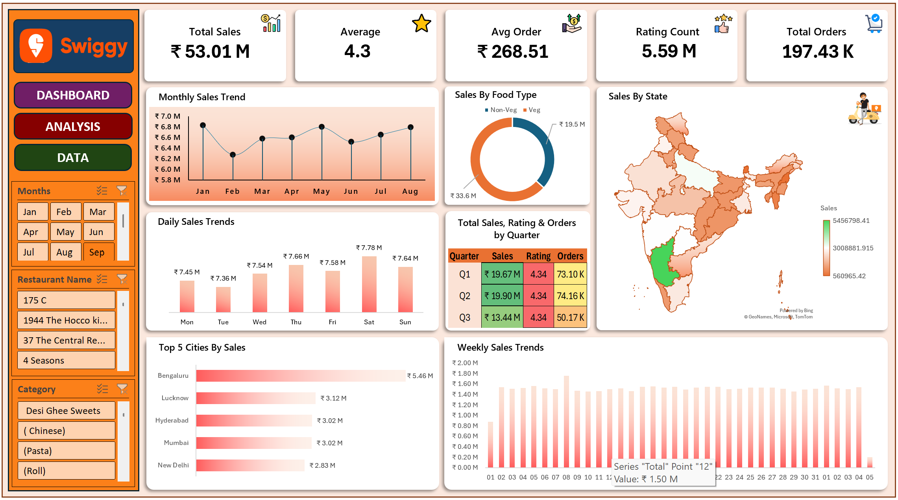

# 🍽️ Swiggy Sales Analysis — Excel Dashboard & Business Insights

*Analyzing 197K+ food-order records to uncover sales trends, category performance, customer ratings, and regional revenue patterns using interactive Excel dashboards.*


## 1. 📌 Project Overview

Analyzed Swiggy food-order data to evaluate sales performance across time, food types, states, and cities using interactive Excel dashboards.

## 2. 🎯 Business Questions & Objectives

- How do sales vary by month, weekday, and quarter?
- Which food type contributes the most to sales?
- Which states and cities generate the highest sales?
- What are the overall order volume, average order value, and customer ratings?
- Where are the key opportunities for further business analysis?

## 3. 📊 Key Findings & Insights

- **Total Sales:** ₹53.01M across 197,430 records.
- **Total Orders:** 197.43K | **Average Order Value:** ₹268.51.
- **Average Rating:** 4.34 | **Rating Count:** 5.59M.
- **Food Type:** Vegetarian sales reached ₹33.56M, versus ₹19.45M for non-vegetarian food.
- **Monthly Performance:** January recorded the highest displayed monthly sales at approximately ₹6.83M.
- **Quarterly Performance:** Q2 recorded approximately ₹19.90M in sales.
- **Top City:** Bengaluru led the displayed cities with approximately ₹5.46M in sales.

## 4. 💡 Business Recommendations

- Monitor monthly and quarterly sales to identify performance changes.
- Evaluate food-category sales to inform category-level strategies.
- Investigate high-performing cities to understand regional sales patterns.
- Compare ratings with sales and order volume to explore customer-experience patterns.
- Use dashboard filters to investigate restaurant, category, and time-period performance.

## 5. 🖼️ Dashboard Preview & Key Visuals

### Dashboard Overview



The interactive dashboard features:

- **KPI Summary:** Sales, ratings, average order value, rating count, and orders.
- **Sales Trends:** Monthly, daily, and date-based patterns.
- **Food Type Analysis:** Vegetarian versus non-vegetarian sales.
- **Geographical Analysis:** State-wise sales and top five cities.
- **Quarterly Performance:** Sales, ratings, and order counts.
- **Interactive Filters:** Explore results by month, restaurant, and category.

## 6. 🛠️ Tools & Technical Skills

- **Microsoft Excel:** Dashboard development and analysis
- **PivotTables & PivotCharts:** KPI summaries and comparisons
- **Data Preparation & EDA:** Organizing data and identifying patterns
- **Data Visualization:** Presenting sales and regional performance
- **Business Analysis:** Translating findings into recommendations

## 7. ⚙️ Methodology & Analytical Workflow

1. Inspected the raw dataset and its structure.
2. Reviewed data completeness and relevant fields.
3. Prepared analytical fields: day, quarter, week, and food type.
4. Aggregated sales, orders, ratings, and average order value.
5. Compared performance across time, food types, states, and cities.
6. Built interactive Excel dashboards with KPIs, charts, and filters.
7. Interpreted findings and identified opportunities for further analysis.

## 8. 📂 Dataset Overview

| Attribute | Details |
|---|---|
| Raw Dataset | `Swiggy Raw Data Excel.xlsx` |
| Records | 197,430 |
| Original Columns | 10 |
| Reporting Period | January–August 2025 |
| Key Fields | State, City, Order Date, Restaurant, Location, Category, Dish, Price, Rating, Rating Count |
| Missing Values | None found in the raw dataset |

The analysis workbook includes additional fields such as **Day, Quarter, Week, and Food Type**.

## 9. 📁 Repository Structure

```text
Swiggy Data Analysis/
├── Data/
│   └── Swiggy Raw Data Excel.xlsx
├── Data Analysis And Dashboard/
│   ├── Swiggy Data Analysis And Dashboard.xlsx
│   └── Images/
│       ├── Dashboard.png
│       ├── swiggy_logo.png
│       ├── swiggy_boy.png
│       ├── checkout.png
│       ├── economics.png
│       ├── rating.png
│       ├── revenue.png
│       └── star.png
├── Problem Statement/
│   └── Swiggy Problem Statement.docx
└── README.md
```

## 10. 🚀 How to Run / Explore the Project

1. Clone or download the repository.
2. Open `Data Analysis And Dashboard/Swiggy Data Analysis And Dashboard.xlsx` in Microsoft Excel.
3. Explore the dashboard and analysis sheets.
4. Use the available filters to examine sales by month, restaurant, and category.
5. Refer to the raw dataset for the underlying records.

## 11. ⚠️ Limitations & Assumptions

- The dataset covers January–August 2025, not a complete calendar year.
- Sales represent the sum of recorded prices, not profit.
- Rating count is the sum of the `Rating Count` field, not the number of orders.
- Observed trends do not establish causation.
- Verify dataset source and redistribution permissions before publishing the raw data.